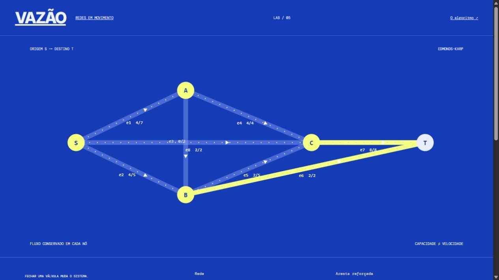

# VAZÃO

Encontrar fluxo máximo e corte mínimo em redes dirigidas sintéticas.

[Experimentar a demo gratuita](https://vazao-gustapaz.starrylinen.chatgpt.site) · [API e modelo](https://vazao-gustapaz.starrylinen.chatgpt.site/api-docs.html) · [Contrato integrado](docs/solution-contract.md)

## Experiência e stack

Diagrama industrial azul elétrico com tubulações animadas por fluxo real e válvulas na própria rede. Layout e movimento próprios, controles nativos por teclado, pausa explícita e prefers-reduced-motion.

- Frontend: **Bobril**. Bundle independente em /experience/.
- Backend: **Worktop + TypeBox**. Edmonds–Karp em rede dirigida: matriz residual, caminhos de aumento e corte mínimo. Teste independente enumera todos os cortes dos grafos limitados.
- D1 persistente, SQL parametrizado, migrações Drizzle. Vinext/Worker para documento SSR e transporte, sem substituir a stack da interface. ClientBoot monta a experiência após a hidratação.

API HTTP de mesma origem; documentação OpenAPI em /api/openapi.json.

## O que funciona de verdade

Alterar condições → calcular no backend → guardar no D1 → reler/editar por revisão → criar/encerrar link de leitura → exportar a revisão salva. Algoritmos, validação, autorização e persistência são reais. Catálogos, nomes, cenários e medidas são sintéticos. Não há fallback silencioso para mocks quando a API falha.

Rede dirigida abstrata. Capacidades em unidades por ciclo, não pressão, vazão física ou dimensionamento hidráulico. Algoritmo Edmonds–Karp e certificado por corte mínimo.

## Executar

Node.js 24+.

```sh
npm ci
npm test
npm run typecheck
npm run check
npm run build
npm run db:migrate
npm start -- --port 59200
# Em outro terminal:
npm run smoke -- http://127.0.0.1:59200
```

Banco local em .wrangler/state, ignorado pelo Git. Testes usam Miniflare e migrações reais em diretórios isolados. Gere novas migrações com npm run db:generate; não altere as já aplicadas. Testes não fazem reset de visitantes. Smoke cria e remove apenas seu próprio registro.

## Gratuidade e dados

Sem cartão, faturamento ou trial. Sites oferece runtime Worker e D1 nesta conta, sujeitos a disponibilidade e cotas, sem promessa de SLA ou gratuidade ilimitada permanente. Retenção de sete dias, 12 criações/hora UTC por demo, até trinta revisões e JSON UTF-8 de 16 KiB.

Token aleatório de recurso de 256 bits, somente digest no banco. Acesso de edição guardado na sessão desta aba; até doze acessos. Links contêm UUID sem token e permitem leitura, nunca edição. Não há recuperação de acesso, conta, senhas, pagamentos ou envio externo. Use somente dados sintéticos e exporte antes de fechar.

## Qualidade e operação

[Arquitetura](docs/architecture.md) · [Segurança](docs/security.md) · [Design](docs/design.md) · [Validação](docs/validation.md)

CI instala pelo lockfile e executa testes, tipos, formatação e build. Capturas e verificações públicas são adicionadas após os testes da demo. Nenhum resultado Lighthouse é declarado sem medição.

## Licenças

Código original [MIT](LICENSE), Gustavo Paz. [Fotografia real licenciada](docs/assets-license.md), [inventário e hashes](docs/assets.json), [dependências e fontes](docs/dependency-licenses.md), textos preservados em docs/third-party/. Não há músicas, marcas, personagens ou imagens de terceiros sem licença.

## Demonstração verificada



[VAZÃO — demo gratuita](https://vazao-gustapaz.starrylinen.chatgpt.site) · [Testes e evidências](docs/validation.md).
